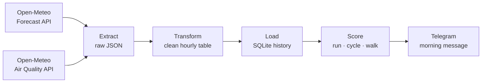

# WeatherWise 🌤️

**A daily data pipeline that tells me the best time to skate, cycle or walk outside in The Hague.**

Every morning, WeatherWise fetches the weather and air quality forecast, stores it in a database, scores every hour for each activity, and sends the result to my phone on Telegram. It runs automatically in the cloud with GitHub Actions.

```
☀️ WeatherWise: The Hague today

⛸ Skating: 13:00–15:00 (score 78)
🚲 Cycling: 13:00–15:00 (score 64)
🚶 Walking: 12:00–14:00 (score 90)

Air quality: moderate
Weather data by Open-Meteo.com
```

---

## How it works



| Step | File | What it does |
|---|---|---|
| Extract | `src/extract.py` | Calls both APIs and saves the raw JSON responses to `data/raw/` |
| Transform | `src/transform.py` | Builds an hourly pandas table, converts wind to Beaufort and weather codes to words, joins air quality on the hour |
| Load | `src/load.py` | Upserts the table into SQLite through a staging table |
| Score | `src/score.py` | Scores each hour from 0–100 per activity and finds the best 2-hour window |
| Digest | `src/digest.py` | Builds the message and sends it with the Telegram Bot API |
| Pipeline | `src/pipeline.py` | Runs all steps in order |

The workflow in `.github/workflows/daily.yml` runs the pipeline every morning and commits the updated database back to the repository, so the forecast history grows day by day.

---

## Design decisions

- **Raw data is kept untouched.** Every API response is saved before any processing, so the cleaning logic can be fixed and re-run without calling the API again.
- **Idempotent loads.** Each row is identified by `(fetched_date, forecast_time)`. Loading uses `INSERT OR REPLACE` from a staging table, so running the pipeline twice on the same day never creates duplicates.
- **Building my own history.** The free API only returns the current forecast. Storing one forecast per day creates a dataset for measuring forecast accuracy over time.
- **Logic separated from output.** `recommend()` returns results instead of printing them, so the same scoring can feed the terminal, Telegram or a future dashboard.
- **Fail fast on configuration.** Missing secrets stop the run with a clear error instead of a confusing API failure.
- **Dutch time everywhere.** GitHub's runners use UTC, so the workflow sets `TZ=Europe/Amsterdam` to keep "today" and "now" correct.

---

## Scoring

Each hour starts at 100 and loses points for bad conditions. The limits per activity live in one config dictionary (`ACTIVITIES` in `score.py`).

| Condition | Penalty |
|---|---|
| Feels-like temperature outside the activity's range | −5 per °C |
| Rain chance above the activity's limit | −1 per % |
| Rain expected (> 0.2 mm) | −30 |
| Wind above the limit | −15 per Beaufort force |
| Gusts above the limit | −10 per Beaufort force |
| Air quality moderate / poor (European AQI > 40 / > 60) | −10 / −30 |

| Activity | Feels-like range | Max rain chance | Max wind | Max gusts |
|---|---|---|---|---|
| Running | 5–18 °C | 30% | 4 Bft | 6 Bft |
| Cycling | 5–25 °C | 20% | 3 Bft | 5 Bft |
| Walking | 0–26 °C | 40% | 5 Bft | 7 Bft |

---

## Data model

One SQLite table, `forecasts`, in `data/weatherwise.db`:

| Column | Description |
|---|---|
| `fetched_date` | Day the forecast was downloaded (part of the primary key) |
| `forecast_time` | Hour the forecast is about (part of the primary key) |
| `temperature_2m`, `apparent_temperature` | Temperature and feels-like temperature (°C) |
| `precipitation_probability`, `precipitation` | Rain chance (%) and amount (mm) |
| `wind_speed_10m`, `wind_gusts_10m` | Wind and gusts (km/h) |
| `wind_bft`, `gust_bft` | Wind and gusts on the Beaufort scale |
| `uv_index`, `weather_code`, `weather` | UV index, WMO weather code and its description |
| `european_aqi`, `pm2_5` | European Air Quality Index and fine dust (µg/m³) |
| `grass_pollen`, `birch_pollen` | Pollen (grains/m³) |

---

## Tech stack

Python · pandas · requests · SQLite · GitHub Actions · Telegram Bot API

---

## Run it yourself

**Requirements:** Python 3.12, Git, and a Telegram bot (create one with [@BotFather](https://t.me/BotFather)).

```bash
git clone https://github.com/ammar-alsharai/weatherwise.git
cd weatherwise
python -m venv .venv
.venv\Scripts\activate          # Windows
# source .venv/bin/activate     # macOS / Linux
pip install -r requirements.txt
```

Create a `.env` file in the project folder:

```
TELEGRAM_BOT_TOKEN=your_bot_token
TELEGRAM_CHAT_ID=your_chat_id
```

Run the full pipeline:

```bash
python src/pipeline.py
```

### Automate it

1. Add `TELEGRAM_BOT_TOKEN` and `TELEGRAM_CHAT_ID` under **Settings → Secrets and variables → Actions**.
2. The workflow runs daily at 05:30 UTC (06:30 Dutch winter time) and can be started manually from the **Actions** tab.

---

## Project structure

```
weatherwise/
├── .github/workflows/daily.yml   # daily schedule
├── src/
│   ├── extract.py
│   ├── transform.py
│   ├── load.py
│   ├── score.py
│   ├── digest.py
│   └── pipeline.py
├── data/
│   ├── raw/                      # raw API responses (not committed)
│   └── weatherwise.db            # forecast history
├── requirements.txt
└── README.md
```

---

## Roadmap

- [x] Fetch forecast and air quality
- [x] Clean and join into an hourly table
- [x] Store forecast history in SQLite
- [x] Score hours per activity
- [x] Morning message on Telegram
- [x] Automate with GitHub Actions
- [ ] Forecast accuracy analysis: how far off is the forecast one and two days ahead?
- [ ] Tests with pytest
- [ ] Dashboard of the week ahead

---

## Data sources and credits

- Weather data by [Open-Meteo.com](https://open-meteo.com/), licensed under [CC BY 4.0](https://creativecommons.org/licenses/by/4.0/). Free for non-commercial use.
- Air quality data from the [Open-Meteo Air Quality API](https://open-meteo.com/en/docs/air-quality-api), based on the Copernicus Atmosphere Monitoring Service (CAMS).

---

## Author

**Ammar Al-sharai** · The Hague, Netherlands
[LinkedIn](https://www.linkedin.com/in/ammar-al-sharai-00769a130/) · [GitHub](https://github.com/ammar-alsharai)
